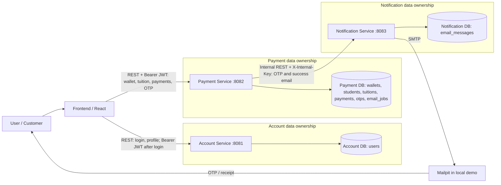

# 2. Kiến trúc Microservices

## 2.1. Phân rã và quyền sở hữu dữ liệu

| Thành phần | Trách nhiệm | Dữ liệu sở hữu | Giao diện truy cập |
|---|---|---|---|
| Frontend (React) | Hiển thị đăng nhập, hồ sơ, số dư, tra cứu MSSV, điều khoản, nhập OTP, kết quả và lịch sử; xử lý trạng thái tải/lỗi. | Không sở hữu dữ liệu nghiệp vụ; chỉ giữ JWT trong phiên giao diện và trạng thái hiển thị. | Gọi Account và Payment qua HTTPS/REST. |
| Account Service (`:8081`) | Xác thực username/password, cấp JWT, trả hồ sơ người dùng đang đăng nhập. | Account DB: `users`, gồm username duy nhất, password hash, họ tên, điện thoại, email. | API người dùng `/api/v1/auth/login`, `/api/v1/users/me`. |
| Payment Service (`:8082`) | Quản lý số dư ví, sinh viên, học phí, giao dịch và OTP; kiểm tra thanh toán toàn bộ; bảo đảm cập nhật tài chính nguyên tử và xử lý đồng thời. | Payment DB: `wallets`, `students`, `tuitions`, `payments`, `otp_challenges`; có thể có `email_jobs` để gửi lại thư sau commit. `user_id` là tham chiếu logic tới Account, không phải khóa ngoại xuyên database. | API người dùng `/api/v1/wallet`, `/api/v1/tuition/{mssv}`, `/api/v1/payments...`; gọi Notification nội bộ. |
| Notification Service (`:8083`) | Tạo nội dung thư OTP/xác nhận, gửi qua SMTP, chống gửi trùng theo `messageId`, ghi trạng thái gửi. Không quyết định giao dịch thành công. | Notification DB: `email_messages(message_id, payload_hash, status, updated_at)`. | API nội bộ `/internal/v1/notifications/email`, chỉ Payment được gọi. |

Mỗi service chỉ đọc/ghi database mình sở hữu. Account phát JWT; Payment xác thực chữ ký, issuer, audience và hạn token trước khi lấy `userId` từ token. Frontend không gửi `userId` hoặc số tiền để quyết định thanh toán. Payment đọc số tiền học phí từ Payment DB và kiểm tra lại số dư, trạng thái học phí khi xác nhận OTP. Password lưu dạng hash; OTP lưu dạng hash và gắn với giao dịch, có hạn 5 phút, dùng thành công một lần.

## 2.2. Giao tiếp và trình tự xử lý

1. Frontend gửi `POST /api/v1/auth/login` đến Account, nhận JWT. Các yêu cầu tới Account/Payment tiếp theo dùng `Authorization: Bearer <JWT>`.
2. Frontend gọi Account `GET /users/me`, Payment `GET /wallet`, `GET /tuition/{mssv}` và `GET /payments` để hiển thị dữ liệu. Đây là REST đồng bộ; giao diện cần timeout, trạng thái chờ và khả năng thử lại thao tác đọc.
3. Frontend gọi Payment `POST /payments` với `tuitionId`, `termsAccepted=true`, `requestId` dạng UUID. Payment tạo giao dịch chờ OTP, sau đó gọi Notification bằng REST nội bộ với header `X-Internal-Key`. Khóa này chỉ nằm trong cấu hình máy chủ, không xuất hiện ở trình duyệt.
4. Notification gửi OTP qua SMTP; `messageId` ổn định giúp yêu cầu gửi lặp cùng nội dung trả kết quả cũ. Cùng ID nhưng khác nội dung bị từ chối.
5. Frontend gọi Payment `POST /payments/{paymentId}/confirm` với OTP. Payment kiểm tra lại trạng thái và số dư, khóa dữ liệu liên quan rồi trừ tiền, gạch nợ, ghi giao dịch, đánh dấu OTP đã dùng trong **một database transaction**. Chỉ một giao dịch được `SUCCESS` cho mỗi khoản học phí.
6. Sau commit, Payment yêu cầu Notification gửi email xác nhận. Nếu gửi lỗi, trạng thái tài chính vẫn `SUCCESS`; công việc gửi thư được ghi để thử lại. Frontend đọc lại số dư và lịch sử từ server.

Luồng xác nhận phải bảo vệ hai trường hợp đồng thời: hai khoản 7 triệu từ cùng ví 10 triệu chỉ cho một khoản thành công; hai ví cùng trả một khoản học phí chỉ cho một giao dịch thành công. Khóa dòng/điều kiện cập nhật và ràng buộc duy nhất ở Payment DB là nơi thực thi quy tắc này, không dựa vào số dư trên giao diện.

## 2.3. Mã Mermaid.js cho Microservices Architecture Diagram

Các cổng là cấu hình phát triển của dự án; khi triển khai có thể đặt reverse proxy/TLS ở phía trước mà không đổi quyền sở hữu dữ liệu. Stack tích hợp hiện dùng Payment Service ở `:8082` và Mailpit làm SMTP thử.

# 3. Thiết kế REST API

## 3.1. Quy ước chung

- Base path: `/api/v1` cho API người dùng; `/internal/v1` cho gọi nội bộ. JSON dùng `Content-Type: application/json`; tiền VND là **số nguyên**, không dùng số thực.
- API bảo vệ người dùng nhận `Authorization: Bearer <JWT>`; Notification nhận `X-Internal-Key`. Không nhận `userId` từ request body để xác định chủ ví/giao dịch.
- Response lỗi thống nhất: `{"code":"VALIDATION_ERROR","message":"Thông báo bằng tiếng Việt"}`. `400` cho dữ liệu sai hoặc trường thừa; `401` cho token thiếu/sai/hết hạn hoặc đăng nhập sai; `403` cho sai khóa nội bộ/không có quyền; `404` cho tài nguyên không tồn tại; `409` cho xung đột trạng thái hoặc idempotency; `422` cho quy tắc nghiệp vụ/OTP không đạt; `503` cho dịch vụ email không sẵn sàng; `500` cho lỗi máy chủ không dự kiến. Không trả stack trace, password hay OTP trong lỗi.
- `GET` không có request body. Các mốc thời gian trả ISO 8601 UTC. `requestId` do client sinh và giữ nguyên khi thử lại cùng yêu cầu. `messageId` do Payment sinh và giữ nguyên khi gửi lại cùng thư.

## 3.2. Danh sách endpoint

| Service | Method | URI | Mục đích | Thành công |
|---|---|---|---|---|
| Account | POST | `/api/v1/auth/login` | Đăng nhập | 200 |
| Account | GET | `/api/v1/users/me` | Hồ sơ người trả tiền | 200 |
| Payment | GET | `/api/v1/wallet` | Số dư ví của chủ JWT | 200 |
| Payment | GET | `/api/v1/tuition/{mssv}` | Tra cứu học phí | 200 |
| Payment | POST | `/api/v1/payments` | Tạo giao dịch, gửi OTP | 201; 200 nếu request lặp hợp lệ |
| Payment | GET | `/api/v1/payments` | Lịch sử giao dịch của chủ JWT | 200 |
| Payment | GET | `/api/v1/payments/{paymentId}` | Chi tiết giao dịch | 200 |
| Payment | POST | `/api/v1/payments/{paymentId}/confirm` | Xác nhận OTP và thanh toán | 200 |
| Notification | POST | `/internal/v1/notifications/email` | Gửi email OTP hoặc biên nhận | 200 |
| Cả ba service | GET | `/api/v1/health` | Kiểm tra tiến trình | 200 |

## 3.3. Account Service

### POST `/api/v1/auth/login`

**Body:** `{"username":"demo1","password":"Demo!2026"}`. Cả hai là chuỗi bắt buộc, không rỗng; `username` tối đa 50 ký tự, `password` tối đa 128; cấm trường thừa. **200:** `{"accessToken":"<JWT>","tokenType":"Bearer","expiresIn":3600}`. **400** `VALIDATION_ERROR` khi body sai; **401** `INVALID_CREDENTIALS` khi thông tin không khớp; **500** `INTERNAL_ERROR` khi lỗi chưa xử lý. Thông báo 401 không phân biệt username hay password sai.

### GET `/api/v1/users/me`

**Header:** Bearer JWT; không có body/query. **200:** `{"userId":"u1","fullName":"Nguyễn Văn An","phone":"0900000001","email":"demo1@example.test"}`. **401** `UNAUTHORIZED` nếu JWT thiếu/sai/hết hạn; **500** `INTERNAL_ERROR`. Không trả password hash.

## 3.4. Payment Service

### GET `/api/v1/wallet`

**Header:** Bearer JWT; không có body/query. **200:** `{"userId":"u1","balance":10000000,"currency":"VND"}`. **401** `UNAUTHORIZED`; **404** `WALLET_NOT_FOUND`; **500** `INTERNAL_ERROR`. `balance` là số nguyên không âm; chỉ đọc ví của chủ JWT.

### GET `/api/v1/tuition/{mssv}`

**Path parameter:** `mssv` gồm đúng 8 chữ số, ví dụ `52600001`; không có query/body. **200:** `{"studentId":"52600001","studentName":"Nguyễn Văn An","tuitionId":"HP001","amount":7000000,"currency":"VND","status":"UNPAID","paidAt":null}`. Khoản `PAID` vẫn trả 200 để hiển thị, nhưng không được thanh toán lại. **400** `VALIDATION_ERROR` nếu MSSV sai định dạng; **401** `UNAUTHORIZED`; **404** `STUDENT_NOT_FOUND` hoặc `TUITION_NOT_FOUND`; **500** `INTERNAL_ERROR`.

### POST `/api/v1/payments`

**Body:** `{"tuitionId":"HP001","termsAccepted":true,"requestId":"2e9d1c7a-7d45-4e1c-9f80-5ff806ef0d11"}`. `tuitionId` bắt buộc, tối đa 100 ký tự; `termsAccepted` phải là `true`; `requestId` là UUID. Không nhận `amount` từ client. **201:** đối tượng `Payment` trạng thái `PENDING_OTP`, gồm `paymentId`, `tuitionId`, `studentId`, `studentName`, `amount`, `currency`, `status`, `createdAt`, `otpExpiresAt`, `paidAt:null`, `failureCode:null`. **200:** cùng `requestId` và cùng nội dung đã khởi tạo trước đó, trả giao dịch hiện tại. **400** `VALIDATION_ERROR`; **401** `UNAUTHORIZED`; **404** `WALLET_NOT_FOUND`/`TUITION_NOT_FOUND`; **409** `TUITION_ALREADY_PAID`, `REQUEST_ID_CONFLICT` hoặc `REQUEST_IN_PROGRESS`; **422** `INSUFFICIENT_BALANCE`; **503** `NOTIFICATION_UNAVAILABLE`; **500** `INTERNAL_ERROR`. Kiểm tra số dư và học phí ở server; thất bại không trừ tiền.

### GET `/api/v1/payments`

**Header:** Bearer JWT; không có body/query trong hợp đồng hiện tại. **200:** `{"items":[<Payment>, ...]}`; không có giao dịch thì `items: []`. Chỉ trả giao dịch của chủ JWT, mới nhất trước. **401** `UNAUTHORIZED`; **500** `INTERNAL_ERROR`.

### GET `/api/v1/payments/{paymentId}`

**Path parameter:** `paymentId` chuỗi 1–100 ký tự; không có body/query. **200:** một đối tượng `Payment`. **401** `UNAUTHORIZED`; **403** `FORBIDDEN` nếu giao dịch thuộc người khác; **404** `PAYMENT_NOT_FOUND`; **500** `INTERNAL_ERROR`.

### POST `/api/v1/payments/{paymentId}/confirm`

**Path parameter:** `paymentId` chuỗi 1–100 ký tự. **Body:** `{"otp":"038271"}`; OTP gồm đúng 6 chữ số. **200:** đối tượng `Payment` trạng thái `SUCCESS`; lặp lại yêu cầu cho giao dịch đã thành công trả cùng kết quả, không trừ thêm. **400** `VALIDATION_ERROR` nếu mã sai định dạng/body thừa; **401** `UNAUTHORIZED`; **403** `FORBIDDEN` nếu không phải chủ giao dịch; **404** `PAYMENT_NOT_FOUND`/`WALLET_NOT_FOUND`; **409** `OTP_DELIVERY_PENDING` hoặc `TUITION_ALREADY_PAID`; **422** `INVALID_OTP`, `OTP_EXPIRED`, `INSUFFICIENT_BALANCE`; **503** `NOTIFICATION_UNAVAILABLE` theo hợp đồng; **500** `INTERNAL_ERROR`. Sai OTP không trừ tiền. Khi OTP hợp lệ, số dư, học phí, giao dịch và trạng thái sử dụng OTP cập nhật nguyên tử. Email xác nhận lỗi sau commit không được biến thanh toán thành thất bại; cần ghi job gửi lại.

**Model `Payment`:** `paymentId`, `tuitionId`, `studentId`, `studentName`, `amount` (integer > 0), `currency:"VND"`, `status` (`PENDING_OTP|SUCCESS|EXPIRED|FAILED`), `createdAt`, `otpExpiresAt` (nullable), `paidAt` (nullable), `failureCode` (nullable). Không bao giờ trả OTP hoặc OTP hash trong model này.

## 3.5. Notification Service

### POST `/internal/v1/notifications/email`

**Header bắt buộc:** `X-Internal-Key: <server-secret>`. **Body OTP:** `{"messageId":"otp:pay_example_001","type":"OTP","to":"demo1@example.test","data":{"paymentId":"pay_example_001","otp":"038271","expiresAt":"2026-11-02T08:05:00Z"}}`. **Body xác nhận:** cùng `messageId`, `to`, nhưng `type:"PAYMENT_SUCCESS"` và `data` gồm `paymentId`, `studentId`, `studentName`, `amount`, `currency`, `paidAt`. `messageId` tối đa 100 ký tự; `to` phải là email hợp lệ; kiểm tra schema theo `type`, cấm trường thừa. **200:** `{"messageId":"otp:pay_example_001","status":"SENT"}` khi gửi được hoặc cùng `messageId`/nội dung đã gửi. **400** `VALIDATION_ERROR`; **403** `FORBIDDEN` nếu khóa nội bộ thiếu/sai; **409** `MESSAGE_ID_CONFLICT` khi ID trùng nhưng payload khác hoặc `REQUEST_IN_PROGRESS`; **503** `NOTIFICATION_UNAVAILABLE` nếu SMTP lỗi; **500** `INTERNAL_ERROR`. Chỉ gửi từ backend; không đưa khóa nội bộ vào frontend.

## 3.6. Kiểm tra dữ liệu và xử lý lỗi xuyên service

Validation chạy tại ranh giới API và được kiểm tra lại ở Payment khi thay đổi tài chính. Với body sai schema hoặc trường thừa, trả `400` cùng mã `VALIDATION_ERROR`. Các lỗi nghiệp vụ trả mã cụ thể như trên; frontend dùng `code` để hiển thị thông điệp phù hợp, không suy luận thành công chỉ từ việc email đã được gửi. Mỗi service ghi log `requestId`/`paymentId` để truy vết, nhưng che password, JWT, OTP và khóa nội bộ. Request gọi Notification đặt timeout; giao dịch tài chính dùng rollback khi lỗi trước commit. Endpoint `/api/v1/health` trả `{"status":"UP","service":"account|payment|notification"}` với `200`, chỉ chứng minh tiến trình phản hồi, không thay thế kiểm thử database/SMTP.

**Nguồn đối chiếu nội bộ:** `cau-hinh-chung/contract/bo-chot-phan-cong-2-nguoi-v1.0/bo-chot-phan-cong-v1/01-openapi.json`, mã Account, Payment, Notification và `src/README.md`. Payment Service đã được tích hợp và kiểm thử các thao tác tài chính cũng như hai trường hợp xử lý đồng thời.
