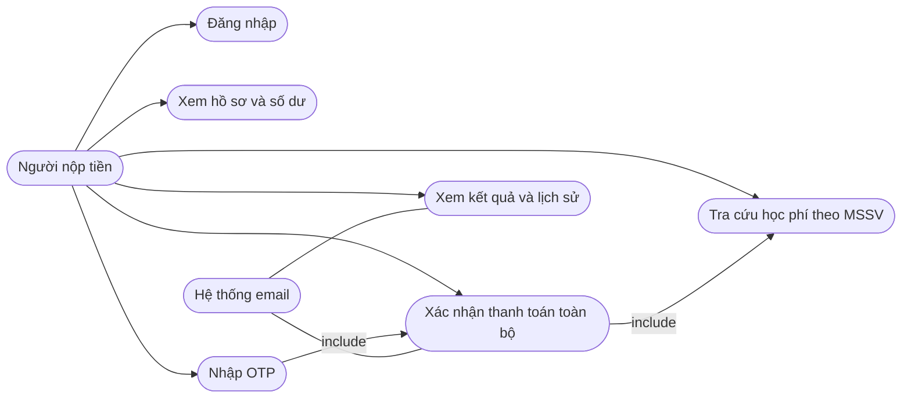
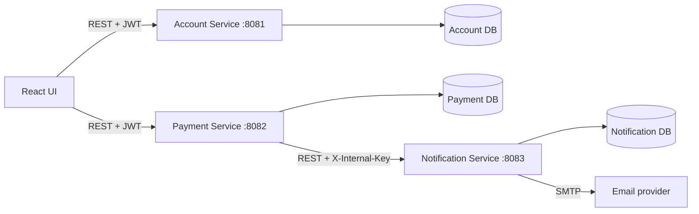

# Thiết kế gói A

## Use Case Diagram

Điều kiện trước: người nộp đã đăng nhập; khoản học phí còn `UNPAID`, số dư đủ, đã đồng ý điều khoản. Điều kiện sau khi thành công: Payment Service cập nhật số dư, công nợ, lịch sử và OTP nguyên tử. Lỗi chính: sai thông tin đăng nhập, MSSV không tồn tại, chưa có công nợ, đã thanh toán, thiếu số dư, OTP sai/hết hạn, email không sẵn sàng.

## Microservices Architecture Diagram

Account sở hữu username, password hash, họ tên, điện thoại, email và JWT. Payment sở hữu ví, sinh viên, học phí, giao dịch, OTP; toàn bộ cập nhật tài chính nằm trong một transaction của Payment DB. Notification sở hữu `messageId` và trạng thái gửi. Giao diện chỉ biết Account và Payment API, không biết khóa nội bộ hay SMTP.

## Luồng của A

1. UI gọi Account `/auth/login`, giữ JWT trong `sessionStorage`.
2. UI gọi `/users/me` và Payment `/wallet`, `/payments` để hiển thị thông tin người nộp, số dư, lịch sử.
3. Khi MSSV đủ 8 chữ số, UI tự gọi Payment `/tuition/{mssv}`. Yêu cầu cũ bị hủy; kết quả cũ không được ghi đè MSSV mới.
4. UI gửi `tuitionId`, `termsAccepted`, `requestId` đến Payment. Payment gửi OTP cho Notification qua API nội bộ.
5. UI nhận OTP từ người dùng, gọi Payment `/payments/{id}/confirm`; sau thành công đọc lại ví và lịch sử.
6. Payment gọi Notification để gửi email thành công sau khi transaction tài chính commit.

## Ranh giới kiểm thử

Payment mock ở cổng 8089 chỉ chứng minh UI xử lý luồng và lỗi. Nó không chứng minh OTP email, transaction, số dư, concurrency hay persistence. Các bằng chứng này phải lấy từ Payment thật của B sau khi ghép.
